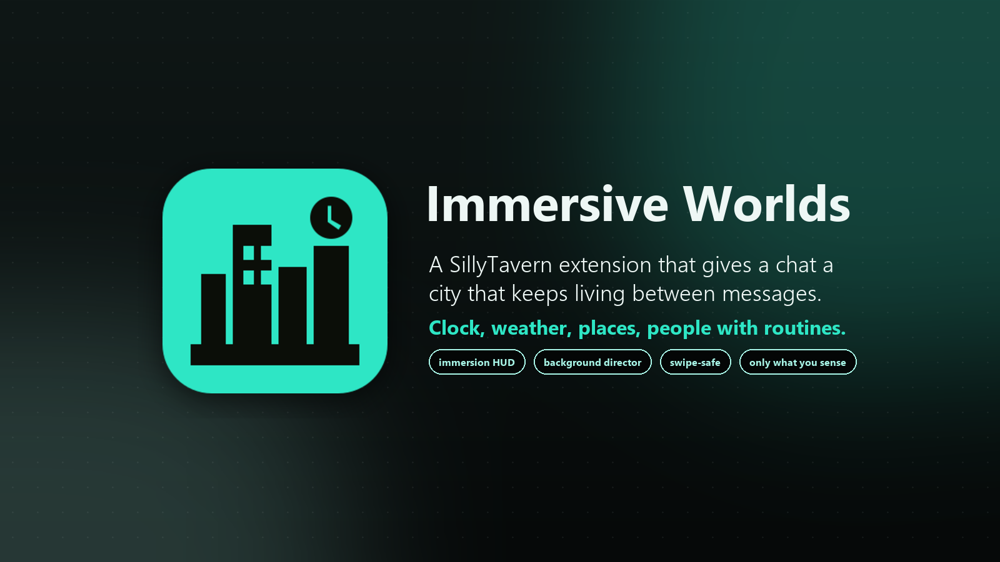
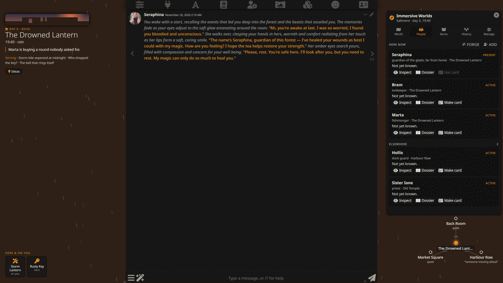
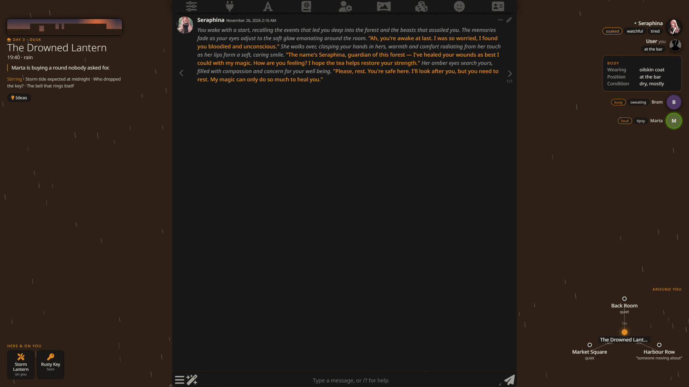
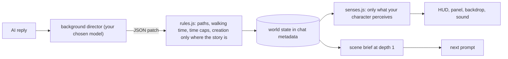
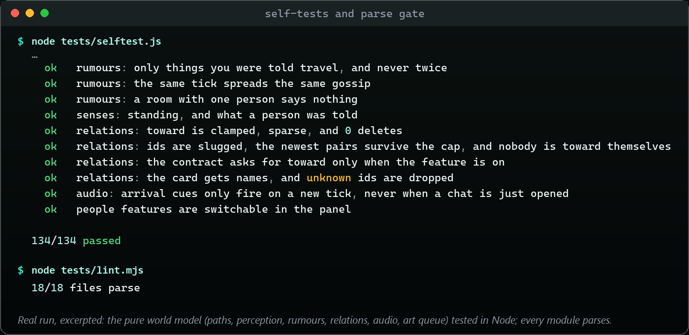

<div align="center">



[](https://github.com/SenjuWoo/ImmersiveWorlds/actions/workflows/ci.yml)
[](https://github.com/SenjuWoo/ImmersiveWorlds/releases/latest)
[](manifest.json)
[](package.json)
[](LICENSE)

**[Install](#install)** · **[Usage](#usage)** · **[Commands](#commands-and-macros)** · **[How it works](#how-it-works)** · **[Settings](docs/settings.md)** · **[Status](#honest-status)** · **[Changelog](CHANGELOG.md)**

</div>

**A city that keeps living between messages.**

A lorebook is a dump. A roleplay city is a simulation: time passes, weather shifts, people have jobs and routines, a shop exists once you mention it, and the next reply already knows the street you are standing on.

Immersive Worlds is a SillyTavern extension that keeps that state in the chat — clock, weather, places, people with routines, items, factions and open threads — and gives the model a short scene brief each turn. It never writes your character's words, thoughts or choices.


## What you get

- **Immersion HUD** in the empty space beside the chat: the scene top-left (place, time, weather, what is happening right now), the people here top-right (2–3 state tags each; hover for body, mind and what they hold), items bottom-left, and a map of the places around you bottom-right
- **Dossier on everyone**: what you have *learned* about a person (what they like and dislike, their history, what they promised, how they stand with you), dated and shown in their card; remove a fact, or add your own note; your edits survive swipes and deletes, and nothing is in the dossier that the story has not shown you
- **Ideas button** (💡): "what could I do next?" gives up to four ideas drawn only from what you know (people's wants and what they said, things at hand, places nearby, open threads); click one to drop it into your message box (it never sends); on request, after every update, or off
- **Faces for everyone**: the character's expression sprite when it has them, else the avatar, else a coloured monogram
- **Pick the background model**: current connection, a connection profile, or any OpenRouter model from a live searchable list (DeepSeek V4.1 Flash is one click), or a model name on your current (local or other) connection
- **Only what your character knows**: people's state is what you actually noticed: if you looked away or something is covered, it isn't there, and their mind is your read of them ("wants: some time alone?"), not their true intent; strangers show as "a dock guard" until someone says their name; next door is *seen* through an open way, *heard* through a door ("two voices arguing") or blank behind a wall; **Peek** through a door; a setting widens it to everything nearby or everything (secrets too)
- **Main cast and background**: character cards are the main cast (portrait, full card, a hidden truth the narrator keeps); everyone the world invents is a background person (a name and a few tags, no portrait), which keeps prompts small
- **Your moves are yours**: Go writes the move into your message, and nothing the narrator writes can move you somewhere you didn't go; comings and goings update the world right away, whatever "Run every" says
- **World logic in code**: every path has a walking time, moving follows the paths and costs that time, people walk instead of teleporting ("heading to the Waystone"), time only jumps when the story sleeps, waits or travels, and new things appear only where the story is
- **Living world per chat**, created only when you ask for one (chats without a world cost nothing)
- **Build world**: one background call drafts places, people, items, factions and threads from the character card, scenario and lorebook. **Start** seeds a minimal world with no model call
- **Scene backdrop** behind the chat, in its own layer (your own background is never touched): a time-of-day and weather grade (dawn, day, dusk, night, darker in storms), optionally a painted scene for the place you are in (city, harbor, tavern, forest, cave, ship, room and more), weather particles (rain, storm, snow, fog, dust) and a small sky-and-skyline strip in the scene card. Off in one click; particles stop under reduced motion
- **Weather you can hear** (off by default): a continuous bed synthesised in the browser — rain, downpour, wind, the hush of snow, fog, and thunder with a lightning flash while a storm lasts. Indoors is quieter and duller, because a tavern in the rain should sound like a room. No sound files, nothing downloaded. One volume, thunder on/off, a Test button, and silence while the tab is in the background. The room has a bed of its own: water in a harbour, fire and a room in a tavern, leaves in a forest, a cave's low tone — plus birds by day, drips, a chair, a coin, and a footstep when someone walks in
- **Generated pictures** (opt in, needs an image backend set up in SillyTavern's Image Generation extension): a picture of the place you are in, one for day and one for night (drawn the first time you are there; weather is drawn over it), portraits for people who have no picture of their own, and item pictures on request. One picture at a time, a per-chat cap, a Test button, and nothing is drawn from anything you have not seen
- **Background director** after each reply: clock, weather, ambient line, who moved where, new people/places/items the scene implied, chronicle notes
- **Routines** (dawn / day / dusk / night): people move with the clock, even off-screen
- **Standing, rumours and relations**: a person's true feeling for you as a bar in their card, gossip passed on between people in the same room (shown as **Told**, never added to your dossier), and who thinks what of whom (**Toward**); each one switchable
- **Swipe-, regenerate- and delete-safe**: every reply caches its own world patch, so browsing swipes re-applies the right state with no extra call, and deleting a reply rewinds the world
- Panel in SillyTavern's own style (MovingUI, theme colours, wand menu): World, People, Items, History, Manage
- **Status strip** above the chat input (day, time, weather, place) and the scene backdrop's time-of-day grade
- **Forge** world-consistent people on demand; turn anyone into a **character card with a world lorebook**
- Export / import world JSON; slash command and macros
- Background calls go to the model you pick (a fast, cheap one is ideal), with reasoning switched off by default and a 120 s timeout

Built for adults. Any resemblance to real persons or places is coincidental.



## Install

Requirements: **SillyTavern ≥ 1.18.0** (tested on 1.19) and any API SillyTavern already speaks.

**Extensions → Install extension** → `https://github.com/SenjuWoo/ImmersiveWorlds`

or

```bash
cd SillyTavern/public/scripts/extensions/third-party
git clone https://github.com/SenjuWoo/ImmersiveWorlds.git
```

A zip of each version is on the [releases page](https://github.com/SenjuWoo/ImmersiveWorlds/releases); unzip it into the same `third-party` folder.

Optional companion: [Immersive Adventures](https://github.com/SenjuWoo/ImmersiveAdventures) (RPG rules, combat, inventory). When both run, the world owns time and place and the adventure owns the hero.

## Usage

1. Open a chat, then **wand menu → Living World** (or `/iw`).
2. **Build world** (AI draft) or **Start** (minimal, no call).
3. Roleplay. After each reply the director updates the world in the background; the HUD follows.
4. **HUD**: hover or click a main character for the full card; click an item for its details; click a place on the map for **Go** (walks there, time passes, and puts "*I make my way to …*" in your message box to send or edit) or **Peek** (through a door, 1 minute, same idea). Click the place name to open the panel. Arrivals glow green, departures fade with where they went.
5. **Panel** (wand menu): **People**: Inspect, Forge, Add, Make card. **World**: travel by clicking an exit. **Manage**: Update now, Edit identity, Rebuild, Export / Import, Remove.

The HUD needs free space beside the chat (wide windows, or a narrower Chat Width in User Settings). With little space it shrinks to faces and icons; on phones it steps aside for the status strip and panel. A side hides while SillyTavern's drawer on that side is open.



## Commands and macros

| Command | Does |
| --- | --- |
| `/iw` | open the panel |
| `/iw start` / `/iw build` | minimal world / AI-drafted world |
| `/iw update` | one director pass now |
| `/iw travel Market` | walk to a place along the paths |
| `/iw ideas` | ask for ideas now and return them |
| `/iw brief` | return the current scene brief |

Macros: `{{iwTime}}` `{{iwDay}}` `{{iwWeather}}` `{{iwLocation}}` `{{iwScene}}`.

Every setting, with its default: [docs/settings.md](docs/settings.md). **Extensions → Immersive Worlds** holds them all; the panel's Manage tab has the two most-used toggles.

## How it works



- **The model narrates; code keeps the world.** The director proposes a patch; `engine.js` and `rules.js` apply it under the rules and reject moves the paths do not allow.
- **Swipe safety**: a pre-turn snapshot plus a per-message cached patch, mirrored into the swipe, so browsing swipes costs no call and a delete rewinds.
- **Pure modules are tested in Node**; the host (`index.js`, `hud.js`) talks to SillyTavern. Module list: [docs/architecture.md](docs/architecture.md).

### Token cost

Measured against v1.5.0 on the same world:

| | v1.5.0 | v2.1.0 |
| --- | --- | --- |
| Fixed instruction text in every reply's prompt | 1,340 chars | 255 chars |
| Whole world note in a typical reply (people's state, exits with minutes, sounds) | — | ~590 chars |
| Director request (instructions + schema + world + exchange) | 4,227 chars of instructions and schema alone, plus the card, the whole state as JSON and 6 messages | ~3,100 chars for the whole request, character sheets included |
| Director input | last 6 messages | only the new exchange |
| Chats without a world | world auto-created, director runs | nothing injected, no calls |

The scene brief sits at depth 1 (`In-chat @ depth`), so everything above it, including the whole chat history, stays prompt-cacheable.

### Log

The browser console (F12 → Console) always shows `[Immersive Worlds] v<version> ready` and every failure with its cause. Turn on **Debug log** in the settings for the resolved settings at startup, every director pass, and every move or change the world rules rejected (with the reason); it logs at the *Verbose* level, so enable that level in the console filter.

## Honest status

```bash
npm test        # node tests/selftest.js: the pure world model
npm run lint    # every module parses
```



CI runs both on every push. Releases 2.0 to 2.4.1 were also checked end to end in an isolated SillyTavern 1.19 against a mock model, and 2.8.1 rendered the standing bar, **Toward** and **Told** there. The 2.6 sound releases were measured in headless Edge rather than inside SillyTavern, and the 2.7.0 and 2.8.0 markup was not rendered when they shipped. What each release covered is in [docs/status.md](docs/status.md).

Not claimed:

- Director, Ideas and dossier quality against a real model (all exercised against a mock; the parsers tolerate fences and prose); in particular the extra `learned` field on DeepSeek V4.1 Flash
- A successful OpenRouter call (no key was available; the request path and its error handling were checked)
- Expression sprites with a real sprite pack (the lookup is feature-detected; avatar and monogram faces were checked)
- SillyTavern 1.18 at runtime (the newer APIs used are feature-detected)
- The HUD re-laying itself on a live window resize was checked with a synthetic resize event (the test browser pane does not fire real ones)

The screenshots above come from a throwaway SillyTavern 1.19.1 with no model connected: the world was imported through **Manage → Import**, so the director did not run for them.

## License

[MIT](LICENSE)
